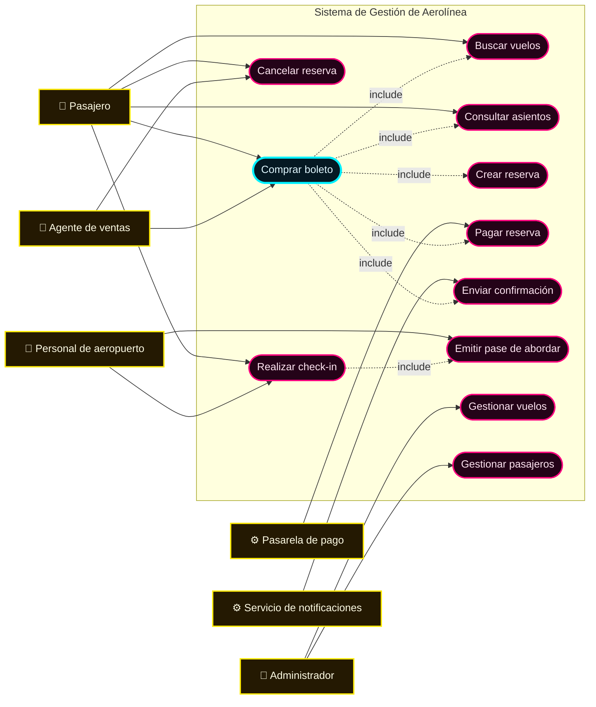
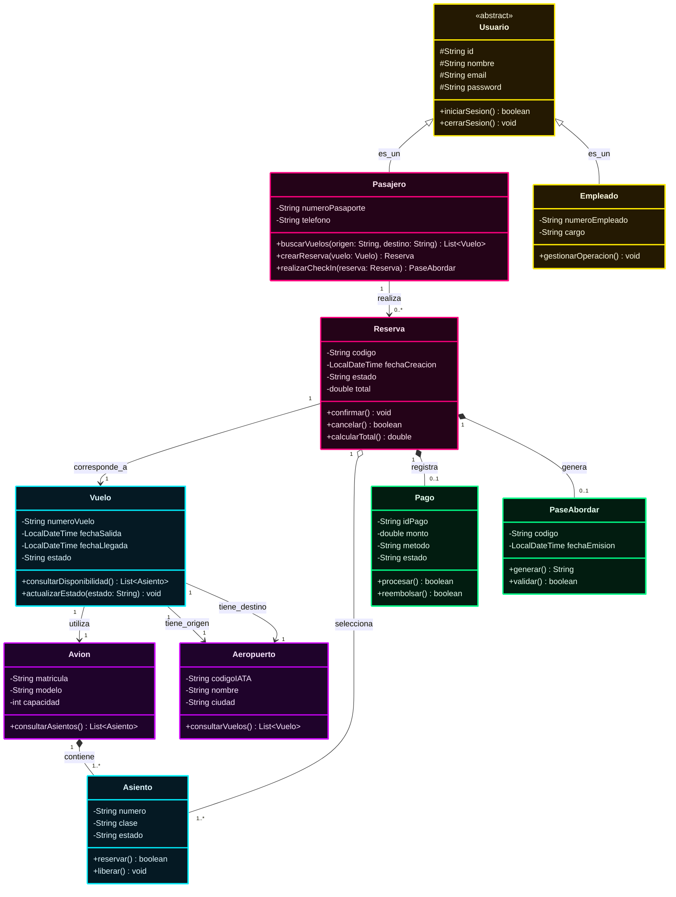
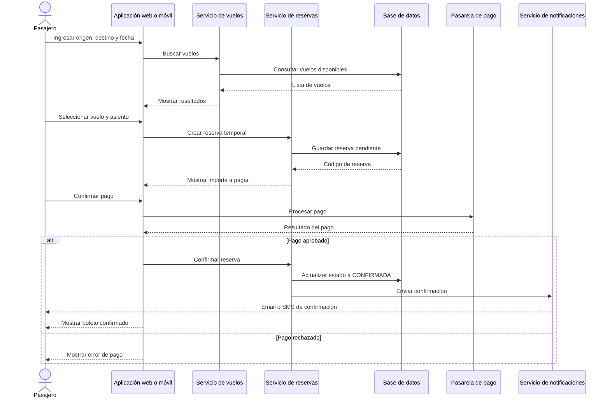
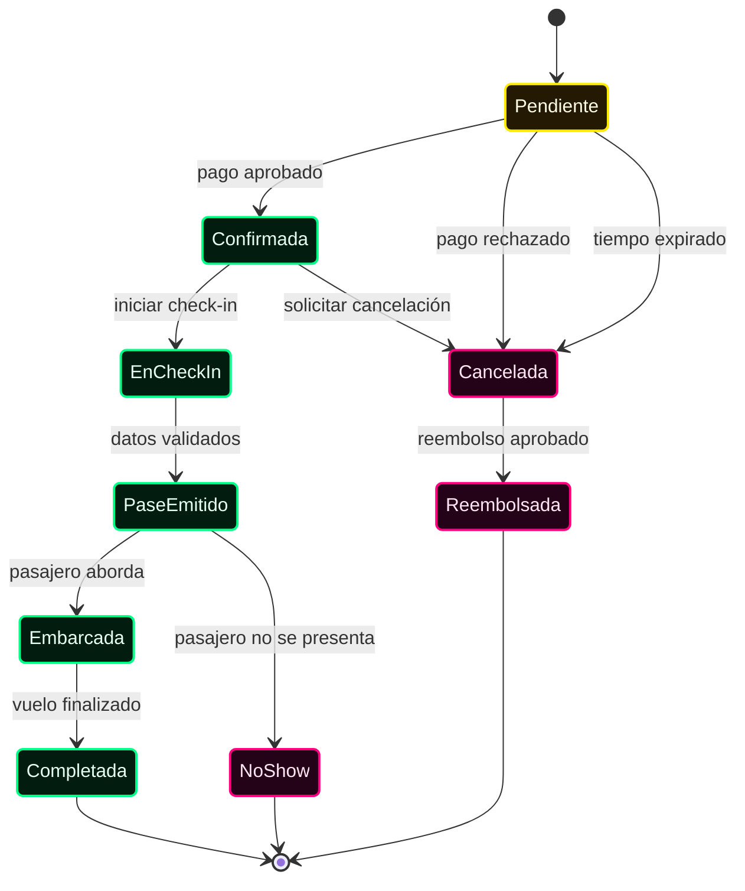
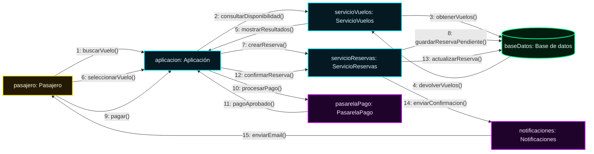
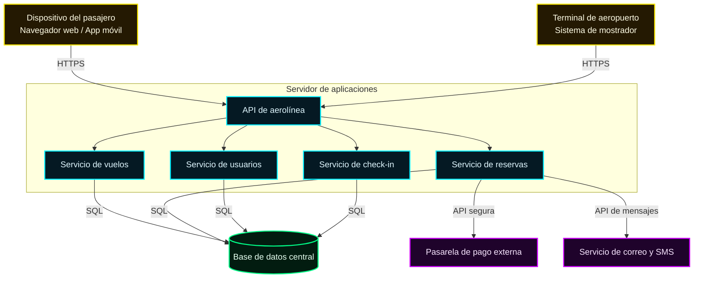
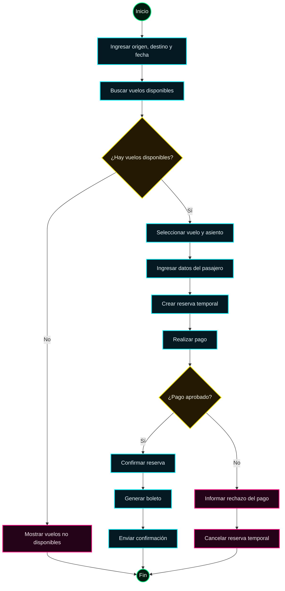

# Arquitectura UML de una Aerolínea

> **Aclaración:** en UML, el diagrama de distribución también se conoce como **diagrama de despliegue**. Representa dispositivos, servidores, componentes y conexiones de red.

## Sistema propuesto

El sistema permite administrar vuelos, pasajeros, reservas, pagos, check-in y pases de abordar.

## Índice

1. [Fase 1: Identificación de actores](#fase-1-identificación-de-actores)
2. [Fase 2: Diagrama de casos de uso](#fase-2-diagrama-de-casos-de-uso)
3. [Fase 3: Diagrama de clases](#fase-3-diagrama-de-clases)
4. [Fase 4: Diagrama de secuencia](#fase-4-diagrama-de-secuencia)
5. [Fase 5: Diagrama de estados](#fase-5-diagrama-de-estados)
6. [Fase 6: Diagrama de colaboración y comunicación](#fase-6-diagrama-de-colaboración-y-comunicación)
7. [Fase 7: Diagrama de distribución o despliegue](#fase-7-diagrama-de-distribución-o-despliegue)
8. [Diagrama complementario de actividad](#diagrama-complementario-de-actividad)

---

# Fase 1: Identificación de actores

## Actores del sistema

| Actor | Descripción |
| :--- | :--- |
| **Pasajero** | Busca vuelos, realiza reservas, paga boletos y hace check-in. |
| **Agente de ventas** | Realiza reservas y cancelaciones en nombre de los pasajeros. |
| **Administrador** | Gestiona vuelos, aviones, aeropuertos, empleados y pasajeros. |
| **Personal de aeropuerto** | Valida pasajeros, realiza check-in y controla el embarque. |
| **Pasarela de pago** | Procesa pagos, reembolsos y devuelve el resultado de las transacciones. |
| **Servicio de notificaciones** | Envía confirmaciones, cambios de horario y avisos por correo o SMS. |

## Casos de uso principales

1. Buscar vuelos.
2. Consultar disponibilidad de asientos.
3. Comprar boleto.
4. Crear reserva.
5. Pagar reserva.
6. Cancelar reserva.
7. Realizar check-in.
8. Emitir pase de abordar.
9. Gestionar vuelos.
10. Gestionar pasajeros.
11. Enviar confirmaciones y notificaciones.

---

# Fase 2: Diagrama de casos de uso

El caso de uso más importante es **Comprar boleto**, porque integra la búsqueda de vuelos, la selección de un asiento, la reserva, el pago y la confirmación.

## Descripción del caso de uso principal: Comprar boleto

1. El pasajero ingresa el origen, el destino y la fecha.
2. El sistema muestra los vuelos disponibles.
3. El pasajero selecciona un vuelo y un asiento.
4. El sistema crea una reserva temporal.
5. El pasajero realiza el pago.
6. La pasarela de pago aprueba o rechaza la transacción.
7. Si el pago es aprobado, el sistema confirma la reserva.
8. El sistema envía la confirmación al pasajero.

---

# Fase 3: Diagrama de clases

## Descripción de las clases principales

- **Usuario:** clase abstracta para las personas que acceden al sistema.
- **Pasajero:** usuario que compra boletos y realiza check-in.
- **Empleado:** usuario que administra operaciones de la aerolínea.
- **Vuelo:** representa un viaje entre dos aeropuertos.
- **Reserva:** relaciona al pasajero con un vuelo y uno o más asientos.
- **Pago:** registra la operación económica de una reserva.
- **PaseAbordar:** documento que permite al pasajero abordar el avión.

## Relaciones UML empleadas

1. **Generalización:** `Pasajero` y `Empleado` heredan de `Usuario`.
2. **Agregación:** una `Reserva` selecciona uno o más `Asiento`.
3. **Composición:** una `Reserva` contiene el `Pago` y el `PaseAbordar` asociados.
4. **Asociación:** el `Pasajero` realiza reservas y el `Vuelo` utiliza un avión.

---

# Fase 4: Diagrama de secuencia

## Escenario: compra de un boleto

---

# Fase 5: Diagrama de estados

Este diagrama representa el ciclo de vida de una **reserva**.

## Estados de la reserva

| Estado | Descripción |
| :--- | :--- |
| **Pendiente** | La reserva fue creada, pero todavía no fue pagada. |
| **Confirmada** | El pago fue aprobado. |
| **EnCheckIn** | El pasajero comenzó el proceso de check-in. |
| **PaseEmitido** | El sistema generó el pase de abordar. |
| **Embarcada** | El pasajero abordó el avión. |
| **Completada** | El vuelo finalizó correctamente. |
| **Cancelada** | La reserva fue cancelada. |
| **Reembolsada** | Se devolvió el dinero al pasajero. |
| **NoShow** | El pasajero no se presentó al vuelo. |

---

# Fase 6: Diagrama de colaboración y comunicación

El diagrama de comunicación muestra cómo colaboran los objetos y el orden de los mensajes.

---

# Fase 7: Diagrama de distribución o despliegue

El diagrama de despliegue muestra dónde se ejecutan los componentes del sistema.

## Componentes de despliegue

- **Dispositivo del pasajero:** navegador web o aplicación móvil.
- **API de aerolínea:** punto de entrada para las solicitudes del sistema.
- **Servicio de vuelos:** consulta y administra vuelos.
- **Servicio de reservas:** crea, confirma y cancela reservas.
- **Servicio de usuarios:** administra autenticación y perfiles.
- **Servicio de check-in:** valida pasajeros y genera pases de abordar.
- **Base de datos central:** almacena vuelos, pasajeros, reservas y pagos.
- **Pasarela de pago:** sistema externo para procesar transacciones.
- **Servicio de notificaciones:** envía emails y mensajes SMS.

---

# Diagrama complementario de actividad

Aunque no aparece como una fase independiente, el diagrama de actividad permite mostrar el flujo completo de compra de un boleto.

---

# Conclusión

La arquitectura propuesta incluye:

- 6 actores externos.
- Más de 5 casos de uso.
- 10 clases principales.
- El flujo completo de compra de boletos.
- El ciclo de vida de una reserva.
- La comunicación entre objetos.
- La distribución física y lógica del sistema.
- 7 diagramas UML nativos de Markdown mediante Mermaid:
  1. Casos de uso.
  2. Clases.
  3. Secuencia.
  4. Estados.
  5. Comunicación.
  6. Despliegue o distribución.
  7. Actividad.
