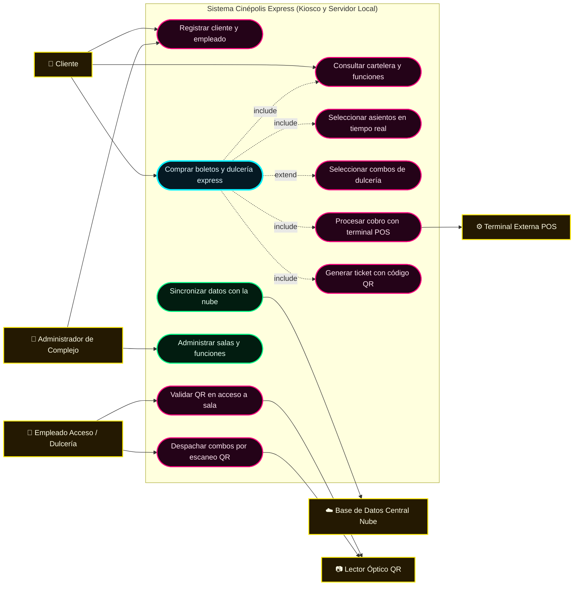
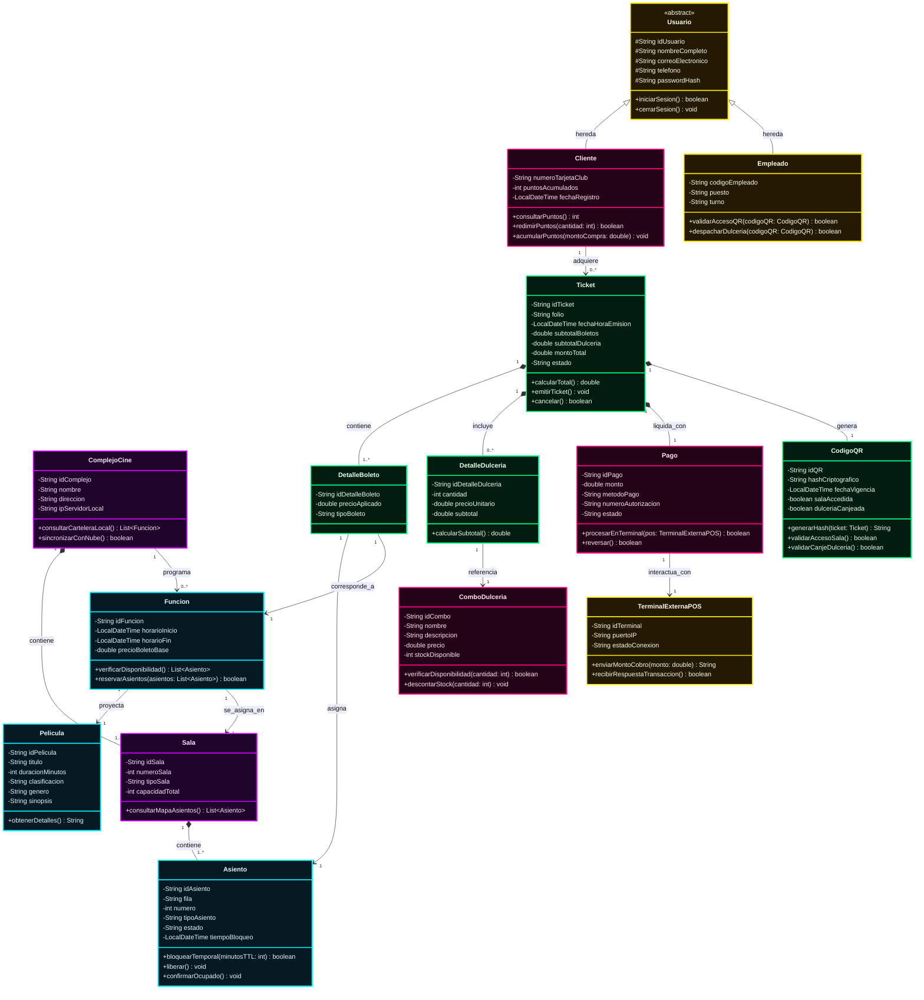
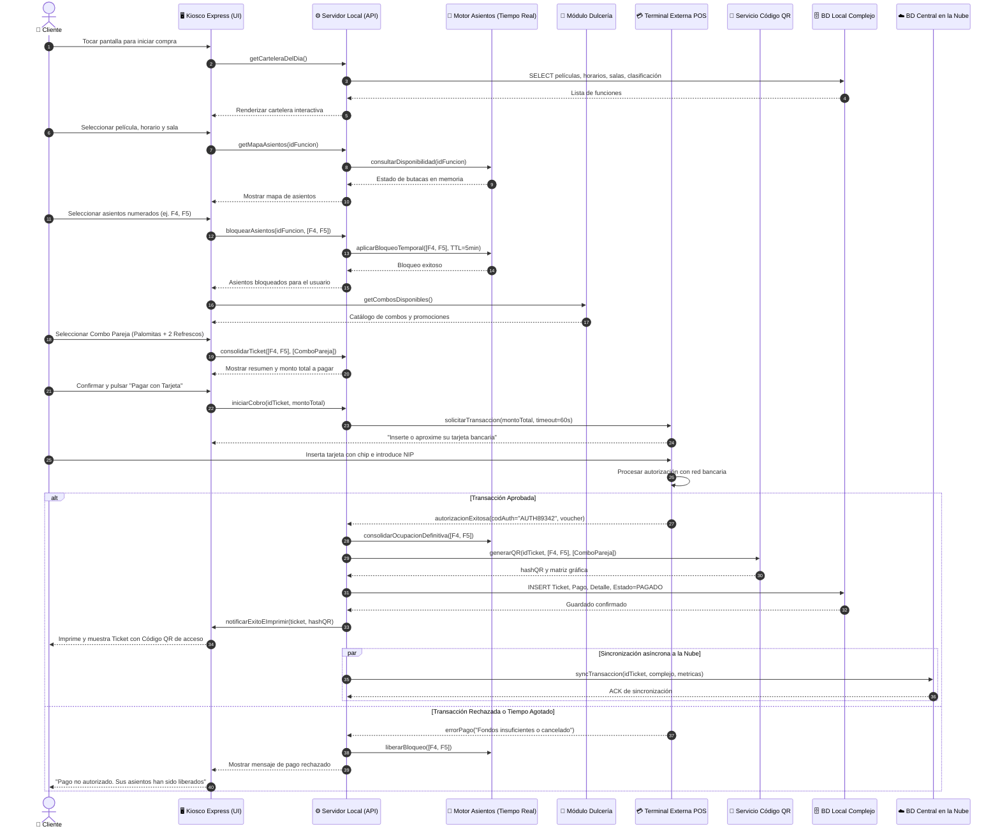
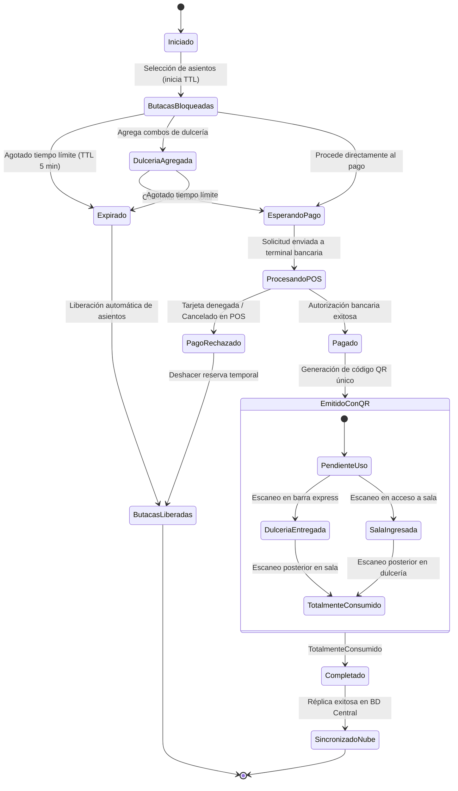
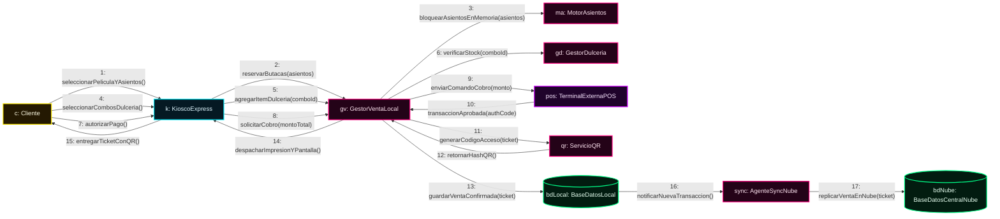
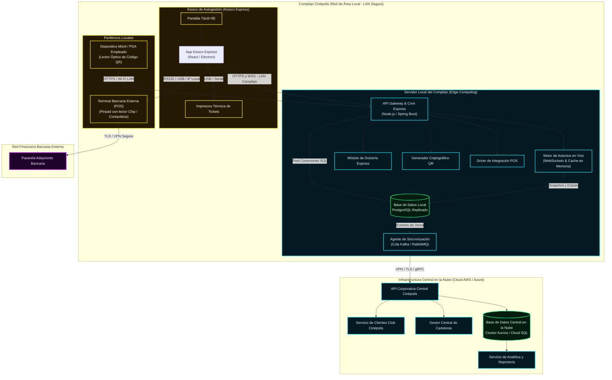

# Arquitectura UML de Cinépolis Express: Sistema de Autogestión

> **Aclaración:** En la metodología y especificación estándar de UML, el **diagrama de distribución** también se conoce como **diagrama de despliegue** (*Deployment Diagram*). Modela la arquitectura física del hardware, los servidores locales y en la nube, los periféricos (terminales POS, lectores QR, kioscos) y los protocolos de comunicación que garantizan la resiliencia y funcionamiento continuo del sistema.

---

## Sistema propuesto

**Cinépolis Express** es una plataforma digital de autogestión diseñada para que los clientes adquieran boletos de cine con asignación de asientos numerados en tiempo real y compren combos de dulcería en una misma transacción, eliminando las filas en taquillas convencionales. 

El sistema opera bajo un modelo de **arquitectura híbrida distribuida**:
1. **Servidores locales en cada complejo cinematográfico**: garantizan respuesta inmediata (baja latencia) para el bloqueo concurrente de asientos en tiempo real, despacho de dulcería y cobro mediante terminales bancarias POS locales, permitiendo que el complejo continúe operando aun ante desconexiones de red externa.
2. **Base de datos central en la nube**: centraliza la administración de usuarios (clientes Club Cinépolis y empleados), catálogos globales de películas, reportería corporativa y sincronización bidireccional continua con cada cine local.
3. **Acceso sin contacto mediante Código QR**: una vez validado el pago con la terminal externa, el sistema emite un ticket digital/físico con código QR único que sirve como pase de acceso a la sala y como vale de recolección prioritaria en la dulcería.

---

## Índice

1. [Fase 1: Identificación de actores y requerimientos](#fase-1-identificación-de-actores-y-requerimientos)
2. [Fase 2: Diagrama de casos de uso](#fase-2-diagrama-de-casos-de-uso)
3. [Fase 3: Diagrama de actividad](#fase-3-diagrama-de-actividad)
4. [Fase 4: Diagrama de clases](#fase-4-diagrama-de-clases)
5. [Fase 5: Diagrama de secuencia](#fase-5-diagrama-de-secuencia)
6. [Fase 6: Diagrama de estados](#fase-6-diagrama-de-estados)
7. [Fase 7: Diagrama de colaboración y comunicación](#fase-7-diagrama-de-colaboración-y-comunicación)
8. [Fase 8: Diagrama de distribución o despliegue](#fase-8-diagrama-de-distribución-o-despliegue)
9. [Conclusión](#conclusión)

---

# Fase 1: Identificación de actores y requerimientos

## Actores del sistema

| Actor | Tipo | Descripción |
| :--- | :--- | :--- |
| **Cliente** | Humano / Principal | Usuario que interactúa con el kiosco express o aplicación para consultar cartelera, seleccionar asientos en tiempo real, adquirir combos de dulcería y realizar el pago. |
| **Empleado (Acceso / Dulcería)** | Humano / Secundario | Personal del complejo que utiliza dispositivos con lector óptico para validar los códigos QR de acceso a salas y despachar los pedidos de dulcería express. |
| **Administrador del Complejo** | Humano / Secundario | Gestiona la apertura de funciones, asignación de salas, control de inventarios de dulcería y monitoreo de empleados locales. |
| **Terminal Externa de Pago (POS)** | Sistema / Hardware | Dispositivo físico bancario que captura las tarjetas de débito/crédito (chip, banda o NFC/contactless) y procesa la transacción financiera de manera segura. |
| **Servicio de Base de Datos Central (Nube)** | Sistema / Externo | Plataforma en la nube que gestiona la autenticación global de usuarios, sincroniza carteleras y consolida las transacciones de todos los complejos. |
| **Lector Óptico de QR** | Sistema / Hardware | Periférico escáner en accesos y barras de dulcería que decodifica y envía el identificador criptográfico del ticket para su redención. |

## Casos de uso principales

1. Registrar e iniciar sesión de clientes y empleados.
2. Consultar cartelera cinematográfica (película, horario, sala y clasificación).
3. Seleccionar asientos numerados con bloqueo en tiempo real.
4. Agregar combos y productos de dulcería asociados al ticket.
5. Procesar pago en terminal bancaria externa (POS).
6. Generar ticket unificado con código QR criptográfico.
7. Validar código QR en torniquete o puerta de acceso a la sala.
8. Canjear y despachar combos de dulcería mediante escaneo de QR.
9. Gestionar cartelera, salas y catálogo de dulcería local.
10. Sincronizar transacciones y catálogos entre el servidor local y la base de datos central en la nube.

---

# Fase 2: Diagrama de casos de uso

El caso de uso nuclear del sistema es **Comprar boletos y combos de dulcería express**, el cual encapsula la selección en vivo de butacas, la venta cruzada de dulcería en el mismo ticket, el pago por terminal POS externa y la generación del código QR de acceso.

## Descripción del caso de uso principal: Comprar boletos y dulcería express

1. **Consulta:** El cliente visualiza la cartelera interactiva en el kiosco, filtrando por película, formato (2D, 3D, VIP), clasificación (A, B, B15, C), sala y horario.
2. **Selección de butacas:** El sistema proyecta el mapa de la sala; el cliente selecciona los asientos numerados y el servidor local los bloquea en tiempo real con un temporizador (TTL) para impedir compras duplicadas.
3. **Venta cruzada de dulcería:** El sistema ofrece el menú de combos y golosinas; el cliente puede agregar uno o varios combos que se asocian de forma indivisible al mismo ticket.
4. **Procesamiento de pago:** El kiosco transfiere el importe total a la **Terminal Externa POS**; el cliente inserta o aproxima su tarjeta bancaria y autoriza el cargo con su NIP o firma digital.
5. **Generación y entrega:** Tras recibir el código de aprobación bancaria, el servidor local confirma la ocupación definitiva de las butacas, registra la venta, genera un **código QR único de alta densidad** e imprime o despliega el ticket digital.
6. **Sincronización:** La venta se asienta en la base de datos local y se encola para su replicación inmediata en la base de datos central en la nube.

---

# Fase 3: Diagrama de actividad

Modela el flujo de control, validaciones y bifurcaciones operativas durante el proceso de autogestión en el kiosco express.

```mermaid
flowchart TD
    Inicio((Inicio))
    VerCartelera["Consultar cartelera: película, sala, horario y clasificación"]
    ElegirFuncion["Seleccionar película y función"]
    CargarMapa["Cargar croquis de sala con disponibilidad en vivo"]
    ElegirAsientos["Seleccionar asientos numerados"]
    VerifDisponibilidad{"¿Asientos libres en servidor local?"}
    BloquearAsientos["Bloquear asientos temporalmente con temporizador"]
    OfrecerDulceria{"¿Desea agregar combos de dulcería?"}
    ElegirCombos["Seleccionar combos y productos de dulcería"]
    AsociarOrden["Consolidar boletos y dulcería en el ticket"]
    Totalizar["Calcular importe total"]
    EnviarPOS["Enviar comando de cobro a Terminal Externa POS"]
    EsperarPago["Cliente aproxima o inserta tarjeta bancaria"]
    PagoExitoso{"¿Transacción aprobada por terminal POS?"}
    ConfirmarVenta["Confirmar ocupación de asientos y descontar inventario"]
    GenerarQR["Generar código QR criptográfico para sala y dulcería"]
    ImprimirTicket["Imprimir / emitir ticket con código QR"]
    SincronizarNube["Replicar venta en Base de Datos Central Nube"]
    ErrorPago["Mostrar motivo de rechazo en pantalla"]
    LiberarAsientos["Liberar bloqueo de asientos inmediatamente"]
    AlertaOcupado["Notificar butacas no disponibles y refrescar sala"]
    Fin((Fin))

    Inicio --> VerCartelera
    VerCartelera --> ElegirFuncion
    ElegirFuncion --> CargarMapa
    CargarMapa --> ElegirAsientos
    ElegirAsientos --> VerifDisponibilidad

    VerifDisponibilidad -->|No| AlertaOcupado
    AlertaOcupado --> CargarMapa
    VerifDisponibilidad -->|Sí| BloquearAsientos

    BloquearAsientos --> OfrecerDulceria
    OfrecerDulceria -->|Sí| ElegirCombos
    ElegirCombos --> AsociarOrden
    OfrecerDulceria -->|No| AsociarOrden

    AsociarOrden --> Totalizar
    Totalizar --> EnviarPOS
    EnviarPOS --> EsperarPago
    EsperarPago --> PagoExitoso

    PagoExitoso -->|No| ErrorPago
    ErrorPago --> LiberarAsientos
    LiberarAsientos --> Fin

    PagoExitoso -->|Sí| ConfirmarVenta
    ConfirmarVenta --> GenerarQR
    GenerarQR --> ImprimirTicket
    ImprimirTicket --> SincronizarNube
    SincronizarNube --> Fin

    classDef inicio fill:#021c10,stroke:#00ff88,stroke-width:2px,color:#e6fff0;
    classDef proceso fill:#051923,stroke:#00f0ff,stroke-width:2px,color:#e0f7ff;
    classDef decision fill:#241902,stroke:#ffea00,stroke-width:2px,color:#fffde6;
    classDef error fill:#240318,stroke:#ff007f,stroke-width:2px,color:#ffe6f2;

    class Inicio,Fin inicio;
    class VerCartelera,ElegirFuncion,CargarMapa,ElegirAsientos,BloquearAsientos,ElegirCombos,AsociarOrden,Totalizar,EnviarPOS,EsperarPago,ConfirmarVenta,GenerarQR,ImprimirTicket,SincronizarNube proceso;
    class VerifDisponibilidad,OfrecerDulceria,PagoExitoso decision;
    class ErrorPago,LiberarAsientos,AlertaOcupado error;
```

---

# Fase 4: Diagrama de clases

Este diagrama describe la estructura estática del modelo orientado a objetos, tipos de datos, visibilidad de atributos, firmas de métodos y relaciones (generalización, composición, agregación y asociación).

## Descripción de las clases principales

- **Usuario:** Clase base abstracta que centraliza la identidad, credenciales y autenticación del sistema.
- **Cliente:** Hereda de `Usuario`; administra la membresía Club Cinépolis, consulta y canje de puntos de lealtad.
- **Empleado:** Hereda de `Usuario`; modela al personal operativo capacitado para validar códigos QR en accesos y despachar dulcería.
- **ComplejoCine:** Representa la sede física del cine y administra sus salas, cartelera y conexión con el servidor local.
- **Pelicula:** Contiene los metadatos cinematográficos, destacando su clasificación de edad y duración para control de accesos.
- **Sala y Asiento:** Modelan el espacio de exhibición y las butacas individuales con control de estado en vivo (`Disponible`, `BloqueadoTemporal`, `Ocupado`).
- **Funcion:** Cruza una película con una sala y un horario específico, fijando el costo de las entradas.
- **ComboDulceria:** Representa paquetes de alimentos (palomitas, refrescos, nachos) con precio y control de existencias.
- **Ticket:** Objeto principal que actúa como agregador de la compra, unificando boletos, dulcería, pago y el código QR de acceso.
- **Pago y TerminalExternaPOS:** Gestionan la solicitud, autorización bancaria y acuse de recibo del cobro físico en tarjeta.
- **CodigoQR:** Representación digital unificada protegida con hash criptográfico para autorizar el paso a la sala y la entrega de alimentos.

---

# Fase 5: Diagrama de secuencia

Modela la interacción cronológica y el paso de mensajes entre el cliente, la interfaz del kiosco, los servicios del servidor local, la terminal POS externa, la base de datos local y la replicación a la nube.

---

# Fase 6: Diagrama de estados

El diagrama describe los estados por los que transita el objeto **Ticket** y la reserva asociada de butacas desde su creación hasta su utilización final en las salas y dulcerías del cine.

## Tabla de estados del Ticket

| Estado | Evento desencadenante | Descripción operativa |
| :--- | :--- | :--- |
| **Iniciado** | El cliente toca la pantalla del kiosco. | Se crea una sesión de venta en memoria. |
| **ButacasBloqueadas** | Selección de asientos numerados. | Las butacas cambian a reservadas temporalmente; se activa un temporizador (TTL de 5 minutos). |
| **DulceriaAgregada** | El cliente selecciona productos de dulcería. | Los artículos se anexan a la misma orden unificando el ticket. |
| **EsperandoPago / ProcesandoPOS** | Confirmación de la orden. | Se bloquea la pantalla del kiosco y se activa la terminal externa POS a la espera de la tarjeta bancaria. |
| **Pagado / EmitidoConQR** | Autorización bancaria confirmada. | Se confirma la compra, se marca la ocupación definitiva y se genera el código QR único. |
| **DulceriaEntregada / SalaIngresada** | Escaneo con lector óptico QR. | El empleado valida el código QR para el ingreso a la sala o la entrega de combos de dulcería. |
| **Completado** | Validación de todos los servicios. | El ticket agota su vigencia tras la función y consumo de dulcería. |
| **Expirado / PagoRechazado** | Falta de pago o tiempo agotado. | Se cancela la transacción y se liberan de inmediato las butacas para otros usuarios. |

---

# Fase 7: Diagrama de colaboración y comunicación

Muestra la interacción dinámica y el orden de los mensajes numerados entre los objetos del software local, la terminal bancaria externa y el enlace en la nube.

---

# Fase 8: Diagrama de distribución o despliegue

Representa la topología de red y los nodos físicos de cómputo donde se despliega cada componente: el hardware de autogestión en el complejo, el servidor edge local y la infraestructura centralizada en la nube.

## Componentes de la arquitectura de despliegue

1. **Kiosco de Autogestión (Front-End en Sala de Espera):**
   - Ejecuta la aplicación gráfica interactiva táctil.
   - Comunica periféricos físicos locales (pantalla táctil e impresora térmica).
   - Se comunica con el servidor local del complejo vía WebSocket (WSS) y HTTPS para refrescar las butacas en milisegundos.
2. **Terminal Externa Bancaria (POS):**
   - Dispositivo físico certificado PCI-DSS para el cobro con tarjeta física, chip y tecnología NFC sin contacto (*contactless*).
   - Conectado al kiosco por puerto serie/USB/Ethernet y a la pasarela bancaria mediante canal encriptado TLS/VPN.
3. **Servidor Local del Complejo (Edge Computing):**
   - **Garantía de alta disponibilidad y tolerancia a fallos:** si la conexión a internet externa se interrumpe, el cine continúa vendiendo boletos, asignando butacas y despachando dulcería de forma ininterrumpida.
   - **Motor de asientos en tiempo real:** gestiona los semáforos de bloqueo temporal en memoria RAM (evitando condiciones de carrera entre usuarios concurrentes).
   - **Base de datos local (PostgreSQL):** almacena las transacciones del día, salas, inventarios locales de dulcería y llaves de cifrado para códigos QR.
4. **Dispositivos Móviles / Lectores de Empleados:**
   - Equipos portátiles de mano (*PDAs*) o torniquetes automáticos que escanean el código QR generado para abrir el acceso o despachar las charolas de dulcería.
5. **Base de Datos Central en la Nube (Cloud Data Center):**
   - Consolida las ventas de todos los complejos del país.
   - Centraliza el padrón de socios Club Cinépolis, catálogos maestros de estrenos, precios corporativos y analítica de negocio en tiempo real.

---

# Conclusión

La arquitectura UML diseñada para **Cinépolis Express** cumple integralmente con los requerimientos de autogestión, alto rendimiento y resiliencia física:

1. **Gestión unificada:** Permite en una sola interacción la selección de funciones, la reserva de asientos en tiempo real y la anexión de combos de dulcería al mismo ticket.
2. **Seguridad y desacoplamiento en pagos:** Integra terminales externas POS bancarias, desligando al software del manejo de datos confidenciales de tarjetas de crédito y cumpliendo normativas de seguridad financiera.
3. **Control de acceso eficiente:** La generación del código QR centraliza en un único identificador digital el pase a sala y el reclamo de productos en la dulcería sin filas.
4. **Arquitectura distribuida Edge-Cloud:** El despliegue en servidores locales por complejo conectado a la nube garantiza que ningún cine se detenga por saturación de red o cortes de internet.
5. **Cobertura UML completa:** Se integraron los 7 diagramas requeridos con sintaxis nativa de Markdown mediante Mermaid:
   - Diagrama de Casos de Uso.
   - Diagrama de Actividad.
   - Diagrama de Clases.
   - Diagrama de Secuencia.
   - Diagrama de Estados.
   - Diagrama de Colaboración y Comunicación.
   - Diagrama de Distribución (Despliegue).
