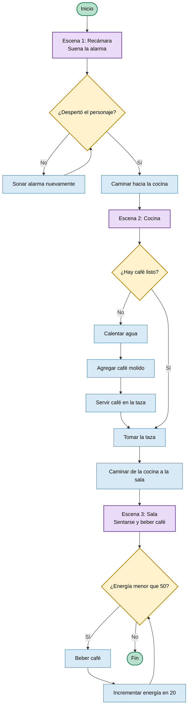

# Diagrama de flujo: Preparar un café matutino

> El bloque con forma de rombo representa una decisión. Las flechas indican el orden del proceso.

## Diagrama visual



## Versión por bloques

```text
╭──────────────╮
│    INICIO    │
╰──────┬───────╯
       ▼
┌─────────────────────────────┐
│ ESCENA 1: RECÁMARA          │
│ Suena la alarma             │
└──────────────┬──────────────┘
               ▼
        ◇ ¿Despertó? ◇
          │ Sí     │ No
          │        ▼
          │  ┌───────────────┐
          │  │ Sonar alarma  │
          │  │ nuevamente    │
          │  └───────┬───────┘
          │          │
          │          └──────► Volver a la decisión
          ▼
┌─────────────────────────────┐
│ Caminar hacia la cocina     │
└──────────────┬──────────────┘
               ▼
┌─────────────────────────────┐
│ ESCENA 2: COCINA            │
└──────────────┬──────────────┘
               ▼
       ◇ ¿Hay café listo? ◇
          │ Sí        │ No
          │           ▼
          │   ┌──────────────────┐
          │   │ Calentar agua    │
          │   ├──────────────────┤
          │   │ Agregar café     │
          │   ├──────────────────┤
          │   │ Servir en taza   │
          │   └────────┬─────────┘
          └────────────┘
               ▼
┌─────────────────────────────┐
│ Tomar la taza               │
└──────────────┬──────────────┘
               ▼
┌─────────────────────────────┐
│ ESCENA 3: SALA              │
│ Sentarse y beber café       │
└──────────────┬──────────────┘
               ▼
       ◇ ¿Energía < 50? ◇
          │ Sí        │ No
          ▼           ▼
┌──────────────────┐  ╭──────────────╮
│ Beber café       │  │     FIN      │
│ Energía += 20    │  ╰──────────────╯
└────────┬─────────┘
         │
         └────────► Volver a la decisión
```

## Formas utilizadas

| Forma | Significado |
| --- | --- |
| Ovalado | Inicio o fin del proceso |
| Rectángulo | Acción o proceso |
| Rombo | Decisión con opciones Sí/No |
| Flecha | Dirección del flujo |
