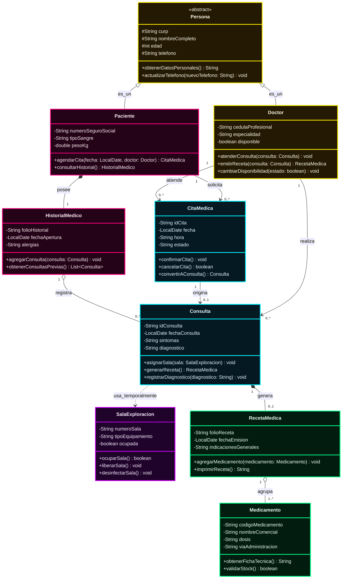

# Diagrama de Clases UML: Sistema de Gestión Hospitalaria

Este documento define la arquitectura orientada a objetos para el **Sistema de Gestión Hospitalaria**, con los nombres de clases, atributos, métodos y documentación en español, y los tipos de datos / palabras reservadas estándar en **inglés** (`String`, `int`, `boolean`, `double`, `void`, `LocalDate`, `List`), junto con estilos visuales **Neón**.

---

## 1. Diagrama de Clases UML (Estilo Neón)

---

## 2. Paleta de Colores Neón por Módulo Hospitalario

| Módulo / Rol | Clases | Color Neón | Código Hex | Propósito |
| :--- | :--- | :--- | :--- | :--- |
| **Personal y Base** | `Persona`, `Doctor` | 🟡 **Amarillo Neón** | `#ffea00` | Jerarquía de personas y profesionales médicos. |
| **Pacientes y Registros** | `Paciente`, `HistorialMedico` | 💖 **Rosa Neón** | `#ff007f` | Datos clínicos y expediente del paciente. |
| **Atención Médica** | `CitaMedica`, `Consulta` | ⚡ **Cyan Neón** | `#00f0ff` | Programación de citas y desarrollo de consultas. |
| **Recursos Físicos** | `SalaExploracion` | 🟣 **Morado Neón** | `#d000ff` | Instalaciones externas utilizadas temporalmente. |
| **Farmacia y Tratamientos**| `RecetaMedica`, `Medicamento`| 🟢 **Verde Neón** | `#00ff88` | Prescripción médica y fármacos asignados. |

---

## 3. Detalle de Clases, Atributos y Métodos

### 3.1. Clase `Persona` (Superclase abstracta)
Encapsula los datos sociodemográficos y de identidad compartidos por médicos y pacientes.
* **Atributos:**
  * `# curp: String`: Clave única de registro de población o identificación oficial.
  * `# nombreCompleto: String`: Nombres y apellidos.
  * `# edad: int`: Edad en años.
  * `# telefono: String`: Número telefónico de contacto.
* **Métodos:**
  * `+ obtenerDatosPersonales(): String`: Devuelve la información básica consolidada.
  * `+ actualizarTelefono(nuevoTelefono: String): void`: Modifica el teléfono de contacto.

---

### 3.2. Clase `Doctor` (Hereda de `Persona`)
Médico certificado responsable de brindar atención y emitir diagnósticos y recetas.
* **Atributos:**
  * `- cedulaProfesional: String`: Número de registro médico oficial.
  * `- especialidad: String`: Rama médica (ej. Cardiología, Pediatría, Medicina General).
  * `- disponible: boolean`: Estado de disponibilidad para consultas.
* **Métodos:**
  * `+ atenderConsulta(consulta: Consulta): void`: Realiza la exploración y evaluación médica.
  * `+ emitirReceta(consulta: Consulta): RecetaMedica`: Confecciona la receta con medicamentos.
  * `+ cambiarDisponibilidad(estado: boolean): void`: Actualiza si está en servicio o en descanso.

---

### 3.3. Clase `Paciente` (Hereda de `Persona`)
Usuario del sistema hospitalario que solicita atención y posee un expediente clínico.
* **Atributos:**
  * `- numeroSeguroSocial: String`: Identificador de afiliación de salud.
  * `- tipoSangre: String`: Grupo sanguíneo y factor Rh (ej. "O+").
  * `- pesoKg: double`: Peso del paciente para dosificación.
* **Métodos:**
  * `+ agendarCita(fecha: LocalDate, doctor: Doctor): CitaMedica`: Solicita una fecha de cita con un médico.
  * `+ consultarHistorial(): HistorialMedico`: Permite visualizar el expediente y consultas anteriores.

---

### 3.4. Clase `CitaMedica`
Programación previa de una sesión de atención entre el paciente y el doctor.
* **Atributos:**
  * `- idCita: String`: Código identificador de la cita.
  * `- fecha: LocalDate`: Día programado.
  * `- hora: String`: Horario asignado (ej. "10:30 AM").
  * `- estado: String`: "Pendiente", "Confirmada", "Cancelada", "Atendida".
* **Métodos:**
  * `+ confirmarCita(): void`: Valida la asistencia del paciente.
  * `+ cancelarCita(): boolean`: Libera el espacio en la agenda del doctor.
  * `+ convertirAConsulta(): Consulta`: Da paso a la consulta presencial activa.

---

### 3.5. Clase `HistorialMedico`
Expediente clínico formal del paciente que acumula el registro de todas sus consultas.
* **Atributos:**
  * `- folioHistorial: String`: Código único de expediente clínico.
  * `- fechaApertura: LocalDate`: Fecha en que el paciente se dio de alta en el hospital.
  * `- alergias: String`: Alergias documentadas a medicamentos o sustancias.
* **Métodos:**
  * `+ agregarConsulta(consulta: Consulta): void`: Anexa una nueva consulta completada al historial.
  * `+ obtenerConsultasPrevias(): List<Consulta>`: Retorna la lista histórica de atenciones recibidas.

---

### 3.6. Clase `Consulta`
Sesión de valoración médica donde se examina al paciente, se diagnostica y se prescribe tratamiento.
* **Atributos:**
  * `- idConsulta: String`: Folio de la consulta.
  * `- fechaConsulta: LocalDate`: Fecha exacta de atención.
  * `- sintomas: String`: Cuadro clínico presentado por el paciente.
  * `- diagnostico: String`: Conclusión médica tras la valoración.
* **Métodos:**
  * `+ asignarSala(sala: SalaExploracion): void`: Asocia la sala donde se efectúa la revisión física.
  * `+ generarReceta(): RecetaMedica`: Crea la orden de medicamentos derivada del diagnóstico.
  * `+ registrarDiagnostico(diagnostico: String): void`: Asienta el resultado médico en el reporte.

---

### 3.7. Clase `SalaExploracion` (Recurso Externo Temporal)
Área física o consultorio equipado que una consulta ocupa transitoriamente y luego libera.
* **Atributos:**
  * `- numeroSala: String`: Identificador de la sala o cubículo (ej. "Sala-2B").
  * `- tipoEquipamiento: String`: Equipos disponibles (ej. "Camilla, Ultrasonido, Electro").
  * `- ocupada: boolean`: Estado actual de disponibilidad.
* **Métodos:**
  * `+ ocuparSala(): boolean`: Bloquea la sala mientras se lleva a cabo la consulta.
  * `+ liberarSala(): void`: Desocupa la sala al terminar la exploración.
  * `+ desinfectarSala(): void`: Marca la sala lista e higienizada para el siguiente paciente.

---

### 3.8. Clase `RecetaMedica`
Documento emitido en la consulta que especifica el tratamiento farmacológico indicado.
* **Atributos:**
  * `- folioReceta: String`: Folio legal de la receta.
  * `- fechaEmision: LocalDate`: Día de expedición.
  * `- indicacionesGenerales: String`: Reposo, dieta o advertencias generales.
* **Métodos:**
  * `+ agregarMedicamento(medicamento: Medicamento): void`: Añade un fármaco con su respectiva dosis a la lista.
  * `+ imprimirReceta(): String`: Genera el formato digital o impreso para el paciente y la farmacia.

---

### 3.9. Clase `Medicamento`
Sustancia o fármaco administrado dentro de la receta médica.
* **Atributos:**
  * `- codigoMedicamento: String`: Código de barras o clave farmacéutica.
  * `- nombreComercial: String`: Nombre comercial o genérico (ej. "Paracetamol 500mg").
  * `- dosis: String`: Cantidad y frecuencia (ej. "1 tableta cada 8 horas por 5 días").
  * `- viaAdministracion: String`: "Oral", "Intravenosa", "Tópica", etc.
* **Métodos:**
  * `+ obtenerFichaTecnica(): String`: Informa sobre precauciones, dosis máxima y presentación.
  * `+ validarStock(): boolean`: Verifica existencias en la farmacia hospitalaria.

---

## 4. Elementos y Relaciones UML Empleadas

1. **Generalización / Herencia (`<|--`)**:
   * `Doctor` y `Paciente` heredan de la clase base `Persona`, reutilizando atributos como CURP, nombre, edad y teléfono.
2. **Composición Fuerte (`*--`)**:
   * `Paciente *-- HistorialMedico`: Un historial médico le pertenece exclusivamente a ese paciente y no existe en el sistema sin él.
   * `Consulta *-- RecetaMedica`: La receta médica nace como resultado directo de la consulta médica realizada.
3. **Agregación (`o--`)**:
   * `HistorialMedico o-- Consulta`: El historial agrupa el conjunto de consultas médicas realizadas a lo largo del tiempo.
   * `RecetaMedica o-- Medicamento`: La receta contiene una lista de medicamentos, los cuales tienen existencia propia en el catálogo de farmacia.
4. **Dependencia / Uso Temporal (`..>`)**:
   * `Consulta ..> SalaExploracion`: La consulta médica **utiliza temporalmente** una sala de exploración como un recurso externo durante la revisión, sin ser dueña de la sala.
5. **Asociaciones (`-->`)**:
   * `Doctor` y `Paciente` se relacionan a través de `CitaMedica` y `Consulta`.
