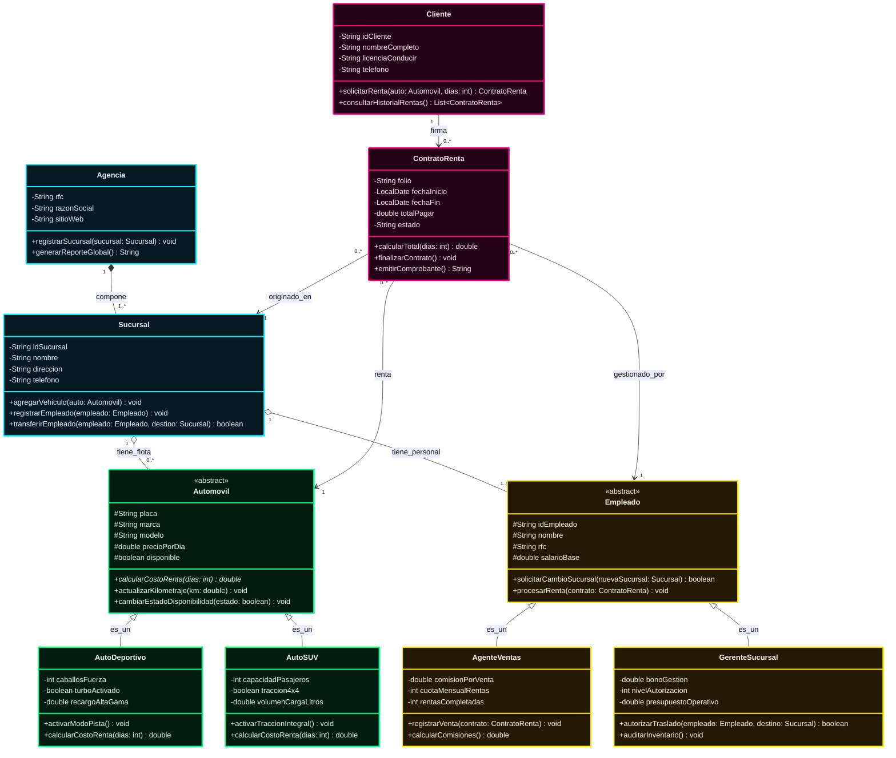

# Diagrama de Clases UML: Sistema de Renta de Vehículos

Este documento describe la arquitectura orientada a objetos para el **Sistema de Renta de Vehículos** de una agencia automotriz, utilizando tipos de datos estándar en inglés (`String`, `int`, `double`, `boolean`, `LocalDate`, `void`, `List`) y estilizado visual con una paleta de colores **Neón / Cyberpunk**.

---

## 1. Diagrama de Clases UML (Estilo Neón)

---

## 2. Paleta de Colores Neón por Módulo

| Módulo / Categoría | Clases Asignadas | Color Neón | Borde Resaltado | Significado Visual |
| :--- | :--- | :--- | :--- | :--- |
| **Infraestructura** | `Agencia`, `Sucursal` | **Cyan Neón** | `#00f0ff` | Red organizacional y puntos físicos. |
| **Flota Vehicular** | `Automovil`, `AutoDeportivo`, `AutoSUV` | **Verde Neón** | `#00ff88` | Activos principales y tipos de vehículos. |
| **Transacciones** | `Cliente`, `ContratoRenta` | **Fucsia / Rosa Neón** | `#ff007f` | Clientes y acuerdos contractuales. |
| **Personal / RRHH** | `Empleado`, `AgenteVentas`, `GerenteSucursal` | **Amarillo Neón** | `#ffea00` | Equipo humano y gestión de traslados. |

---

## 3. Detalle de Clases, Atributos y Métodos

### 3.1. Clase `Agencia` (Cyan Neón)
Administra la red global de sucursales de la empresa.
* **Atributos:**
  * `- rfc: String`: Registro fiscal de la agencia.
  * `- razonSocial: String`: Nombre legal o corporativo de la empresa.
  * `- sitioWeb: String`: Portal digital de la agencia.
* **Métodos:**
  * `+ registrarSucursal(sucursal: Sucursal): void`: Registra una nueva sucursal en la red.
  * `+ generarReporteGlobal(): String`: Consolida el balance y las operaciones de todas las sucursales.

---

### 3.2. Clase `Sucursal` (Cyan Neón)
Punto físico donde se encuentran los automóviles y el personal asignado.
* **Atributos:**
  * `- idSucursal: String`: Identificador único de la sucursal.
  * `- nombre: String`: Nombre comercial o sede (ej. "Sucursal Centro").
  * `- direccion: String`: Ubicación física de la sucursal.
  * `- telefono: String`: Número telefónico de contacto.
* **Métodos:**
  * `+ agregarVehiculo(auto: Automovil): void`: Asigna un vehículo al inventario disponible de esta sucursal.
  * `+ registrarEmpleado(empleado: Empleado): void`: Da de alta a un nuevo empleado en la sucursal.
  * `+ transferirEmpleado(empleado: Empleado, destino: Sucursal): boolean`: Tramita el traslado del empleado hacia otra sucursal.

---

### 3.3. Clase `Automovil` (Verde Neón - Superclase abstracta)
Define las características y comportamientos comunes de cualquier vehículo en renta.
* **Atributos:**
  * `# placa: String`: Matrícula del automóvil.
  * `# marca: String`: Fabricante del vehículo (ej. Toyota, Ford).
  * `# modelo: String`: Modelo y año del vehículo.
  * `# precioPorDia: double`: Costo base de la tarifa diaria.
  * `# disponible: boolean`: Indica si el auto está libre para renta.
* **Métodos:**
  * `+ calcularCostoRenta(dias: int): double`: Método polimórfico para calcular el importe total.
  * `+ actualizarKilometraje(km: double): void`: Registra el kilometraje recorrido.
  * `+ cambiarEstadoDisponibilidad(estado: boolean): void`: Modifica el estatus (disponible o rentado).

#### Subclases de Automóvil (Herencia):
* **`AutoDeportivo`**:
  * **Atributos:** `- caballosFuerza: int`, `- turboActivado: boolean`, `- recargoAltaGama: double`
  * **Métodos:** `+ activarModoPista(): void`, `+ calcularCostoRenta(dias: int): double` *(sobrescrito)*
* **`AutoSUV`**:
  * **Atributos:** `- capacidadPasajeros: int`, `- traccion4x4: boolean`, `- volumenCargaLitros: double`
  * **Métodos:** `+ activarTraccionIntegral(): void`, `+ calcularCostoRenta(dias: int): double` *(sobrescrito)*

---

### 3.4. Clase `Cliente` (Rosa Neón)
Representa al usuario final que solicita la renta de un vehículo.
* **Atributos:**
  * `- idCliente: String`: Clave única del cliente.
  * `- nombreCompleto: String`: Nombres y apellidos.
  * `- licenciaConducir: String`: Número oficial de la licencia de conducir vigente.
  * `- telefono: String`: Teléfono de contacto.
* **Métodos:**
  * `+ solicitarRenta(auto: Automovil, dias: int): ContratoRenta`: Inicia la solicitud formal de renta de un auto.
  * `+ consultarHistorialRentas(): List<ContratoRenta>`: Devuelve los contratos del cliente.

---

### 3.5. Clase `ContratoRenta` (Rosa Neón)
Entidad que formaliza la transacción entre el cliente, el automóvil, el empleado que atiende y la sucursal.
* **Atributos:**
  * `- folio: String`: Clave única del contrato.
  * `- fechaInicio: LocalDate`: Fecha en que el cliente recibe el vehículo.
  * `- fechaFin: LocalDate`: Fecha pactada de entrega.
  * `- totalPagar: double`: Importe monetario a pagar.
  * `- estado: String`: Estatus ("Activo", "Finalizado", "Cancelado").
* **Métodos:**
  * `+ calcularTotal(dias: int): double`: Determina el importe total a cobrar según los días y tarifas.
  * `+ finalizarContrato(): void`: Cierra el contrato y libera el automóvil.
  * `+ emitirComprobante(): String`: Genera el comprobante de pago o factura.

---

### 3.6. Clase `Empleado` (Amarillo Neón - Superclase abstracta)
Personal de la empresa que labora en una sucursal y puede solicitar cambio de lugar de trabajo.
* **Atributos:**
  * `# idEmpleado: String`: Clave del trabajador.
  * `# nombre: String`: Nombre completo del empleado.
  * `# rfc: String`: Registro de identificación fiscal.
  * `# salarioBase: double`: Salario asignado.
* **Métodos:**
  * `+ solicitarCambioSucursal(nuevaSucursal: Sucursal): boolean`: **Permite al empleado solicitar su traslado a otra sucursal.**
  * `+ procesarRenta(contrato: ContratoRenta): void`: Valida y da trámite al contrato de renta.

#### Subclases de Empleado (Herencia):
* **`AgenteVentas`**:
  * **Atributos:** `- comisionPorVenta: double`, `- cuotaMensualRentas: int`, `- rentasCompletadas: int`
  * **Métodos:** `+ registrarVenta(contrato: ContratoRenta): void`, `+ calcularComisiones(): double`
* **`GerenteSucursal`**:
  * **Atributos:** `- bonoGestion: double`, `- nivelAutorizacion: int`, `- presupuestoOperativo: double`
  * **Métodos:** `+ autorizarTraslado(empleado: Empleado, destino: Sucursal): boolean`, `+ auditarInventario(): void`

---

## 4. Elementos de UML Utilizados

1. **Visibilidad:**
   * `+` **Público**: Accesible desde cualquier clase.
   * `-` **Privado**: Solo accesible dentro de la propia clase.
   * `#` **Protegido**: Accesible por la clase y sus subclases.
2. **Tipos de datos estándar en inglés:**
   * `String` (texto)
   * `int` (números enteros)
   * `double` (números con punto flotante)
   * `boolean` (verdadero / falso)
   * `LocalDate` (fechas de calendario)
   * `void` (sin valor de retorno)
   * `List` (colecciones de elementos)
3. **Relaciones:**
   * **Generalización / Herencia (`<|--`)**: `Automovil` con sus tipos (`AutoDeportivo`, `AutoSUV`) y `Empleado` con sus tipos (`AgenteVentas`, `GerenteSucursal`).
   * **Composición (`*--`)**: `Agencia` contiene una o varias `Sucursal` (dependencia existencial fuerte).
   * **Agregación (`o--`)**: `Sucursal` contiene `Automovil` y `Empleado` (el empleado puede cambiar de sucursal y el auto puede transferirse).
   * **Asociación (`-->`)**: Interacción entre `Cliente`, `ContratoRenta`, `Automovil`, `Empleado` y `Sucursal`.
