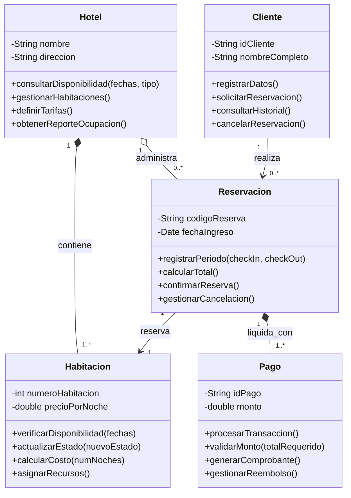

# Ejercicio 2 - Análisis: Sistema de Reservaciones de Hotel

## 1. Requisitos Funcionales (RF)

| Requisito Funcional | Descripción | Prioridad |
| :--- | :--- | :---: |
| **Búsqueda y consulta de disponibilidad** | El sistema debe permitir buscar habitaciones disponibles filtrando por fecha de entrada, fecha de salida, tipo de habitación y número de huéspedes. | **Alta** |
| **Registro y confirmación de reservaciones** | El sistema debe permitir registrar y confirmar reservaciones asignando un código único alfanumérico una vez completado el anticipo requerido. | **Alta** |
| **Gestión de modificaciones y cancelaciones** | El cliente o recepcionista debe poder cancelar o modificar fechas de una reservación, aplicando las políticas de penalización o reembolso vigentes. | **Alta** |
| **Procesamiento y control de pagos** | El sistema debe procesar pagos (anticipos, liquidaciones y reembolsos) mediante diversos métodos de pago y emitir comprobantes digitales. | **Alta** |
| **Gestión de Check-in y Check-out** | El personal del hotel debe poder registrar el ingreso formal del huésped (*Check-in*) y su salida (*Check-out*), liberando la habitación para el proceso de limpieza. | **Alta** |
| **Administración de catálogo e inventario** | El administrador debe poder crear, editar o inhabilitar habitaciones, definir tipos de habitación, capacidad máxima y tarifas base o de temporada. | **Media** |
| **Reportes de ocupación y ventas** | El sistema debe generar reportes estadísticos de ocupación hotelera, ingresos por periodo y tasas de cancelación. | **Media** |

---

## 2. Requisitos No Funcionales (RNF)

| Requisito No Funcional | Criterio de Medición / Especificación | Prioridad |
| :--- | :--- | :---: |
| **Consistencia y prevención de Overbooking** | El sistema debe implementar control estricto de concurrencia y transacciones para garantizar que una misma habitación no sea reservada simultáneamente por dos clientes en el mismo periodo. | **Alta** |
| **Rendimiento y tiempo de respuesta** | Las consultas de disponibilidad de habitaciones y el procesamiento de reservaciones deben completarse en menos de 2 segundos. | **Alta** |
| **Disponibilidad y confiabilidad** | La plataforma de reservaciones debe garantizar una tasa de disponibilidad operativa del 99.8% (24/7). | **Alta** |
| **Seguridad de datos y pagos** | Toda transmisión de datos sensibles (datos del huésped y transacciones bancarias) debe realizarse cifrada mediante HTTPS/TLS cumpliendo con estándares de seguridad. | **Alta** |
| **Usabilidad y diseño responsivo** | La interfaz debe adaptarse a dispositivos móviles y computadoras de escritorio, permitiendo a un usuario completar su reserva en un máximo de 4 pasos intuitivos. | **Media** |

---

## 3. Identificación de Clases Candidatas

### **Clase 1: Cliente**
* **Atributos:**
  1. `idCliente: String` (Identificación oficial, RFC o Pasaporte)
  2. `nombreCompleto: String` (Nombres y apellidos del huésped)
* **Responsabilidades:**
  1. Registrar y actualizar su información personal y datos de contacto.
  2. Solicitar la creación de una nueva reservación de habitación.
  3. Consultar el historial y estado actual de sus reservaciones.
  4. Solicitar la modificación o cancelación de una reservación previamente creada.

---

### **Clase 2: Habitacion**
* **Atributos:**
  1. `numeroHabitacion: int` (Identificador físico de la habitación)
  2. `precioPorNoche: double` (Tarifa base por noche)
* **Responsabilidades:**
  1. Verificar su disponibilidad para un intervalo específico de fechas.
  2. Actualizar su estado operativo (*Disponible*, *Ocupada*, *Mantenimiento*, *Limpieza*).
  3. Calcular el costo base de hospedaje según la cantidad de noches solicitadas.
  4. Asignar o liberar los recursos físicos de la habitación durante el *Check-in* o *Check-out*.

---

### **Clase 3: Reservacion**
* **Atributos:**
  1. `codigoReserva: String` (Código alfanumérico único de confirmación)
  2. `fechaIngreso: Date` (Fecha de inicio de la estancia / *Check-in*)
* **Responsabilidades:**
  1. Registrar el periodo de estancia (fecha de entrada y fecha de salida).
  2. Calcular el importe total a liquidar (estancia, impuestos y recargos).
  3. Confirmar la reservación una vez validada la disponibilidad y el anticipo/pago.
  4. Aplicar políticas de cancelación, penalización o reembolso según los plazos establecidos.

---

### **Clase 4: Pago**
* **Atributos:**
  1. `idPago: String` (Identificador único de la transacción)
  2. `monto: double` (Valor económico abonado)
* **Responsabilidades:**
  1. Procesar la transacción conforme al método de pago seleccionado (*Tarjeta*, *Transferencia*, *Efectivo*).
  2. Validar que el monto cubra el importe requerido de anticipo o liquidación total.
  3. Generar el comprobante o recibo digital de la operación.
  4. Gestionar reembolsos o devoluciones autorizadas en caso de cancelaciones en tiempo y forma.

---

### **Clase 5: Hotel**
* **Atributos:**
  1. `nombre: String` (Nombre comercial del establecimiento)
  2. `direccion: String` (Ubicación física del hotel)
* **Responsabilidades:**
  1. Administrar el catálogo e inventario total de habitaciones.
  2. Consultar y filtrar habitaciones disponibles según tipo, capacidad y rango de fechas.
  3. Definir y actualizar tarifas base, temporadas y reglas de reserva.
  4. Consolidar el registro central y reportes de ocupación y reservaciones.

---

## 4. Reglas del Negocio (RN)

| # | Regla de Negocio | Descripción |
|---|---|---|
| **RN-01** | **Coherencia de Fechas y Disponibilidad Exclusiva** | La fecha de salida (*Check-out*) debe ser estrictamente posterior a la fecha de entrada (*Check-in*). Una habitación no puede admitir dos reservaciones confirmadas que coincidan total o parcialmente en el mismo rango de fechas. |
| **RN-02** | **Anticipo Obligatorio para Confirmación** | Toda reservación creada en estado *Pendiente* requiere un pago mínimo de anticipo (p. ej. 20% del total o el valor de la primera noche) en un plazo no mayor a 24 horas; de no registrarse el pago, la reservación caduca automáticamente y la habitación vuelve a estar disponible. |
| **RN-03** | **Políticas de Cancelación y Penalización** | La cancelación es gratuita con reembolso del 100% únicamente si se solicita con al menos 48 horas de anticipación a la fecha de ingreso. Cancelaciones posteriores o inasistencias (*No-Show*) generan una penalidad equivalente al cobro de la primera noche de estancia. |
| **RN-04** | **Límite de Ocupación por Habitación** | La cantidad total de huéspedes asignados no puede exceder la capacidad máxima permitida para la categoría de habitación reservada (Individual: 1, Doble: 2, Suite: 4). |

---

## 5. Diagrama de Clases Inicial

