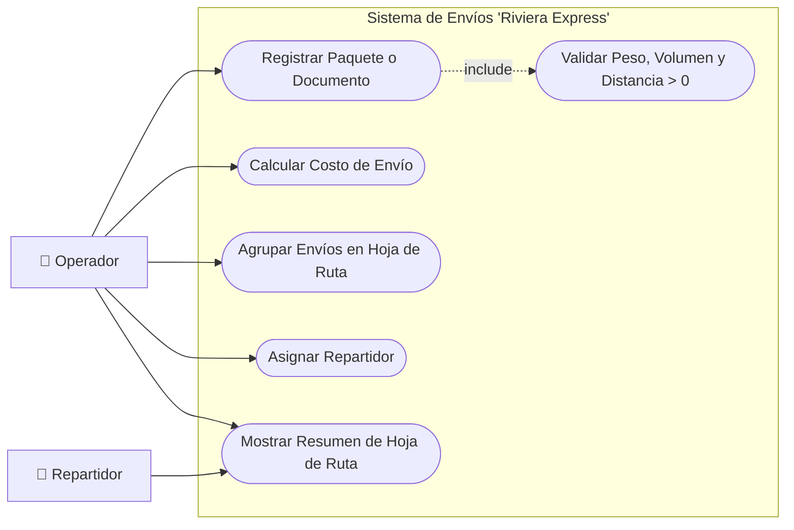
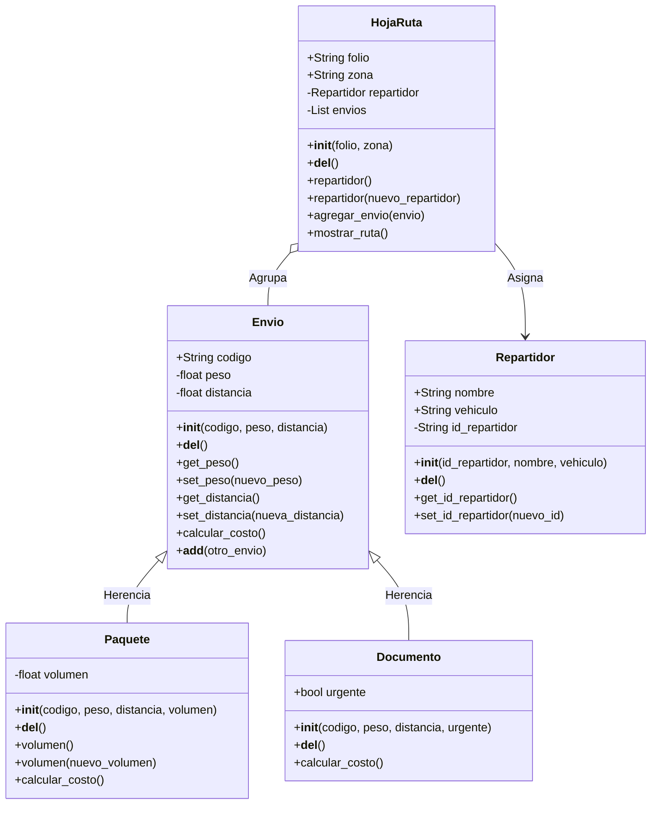

# Fases 2 y 3: Análisis y Diseño · "Riviera Express"

## Fase 2: Análisis

### 2.1 Identificación de Objetos / Clases Candidatas

1. **`Envio` (Superclase)**:
   - **Atributos**: `+codigo`, `-peso`, `-distancia`.
   - **Responsabilidades**: Validar que peso y distancia no sean negativos (`get`/`set`), calcular el costo base y sobrecargar el operador `+` (`__add__`) para sumar el costo de dos envíos.
2. **`Paquete` (Subclase de `Envio`)**:
   - **Atributos propios**: `-volumen`.
   - **Responsabilidades**: Validar que el volumen no sea negativo (`@property`) y calcular el costo sumando el volumen al costo base heredado.
3. **`Documento` (Subclase de `Envio`)**:
   - **Atributos propios**: `+urgente`.
   - **Responsabilidades**: Calcular el costo sumando un cargo extra si el documento es urgente.
4. **`Repartidor`**:
   - **Atributos**: `+nombre`, `+vehiculo`, `-id_repartidor`.
   - **Responsabilidades**: Guardar los datos del repartidor responsable y proteger su ID con `get`/`set`.
5. **`HojaRuta`**:
   - **Atributos**: `+folio`, `+zona`, `-repartidor`, `-envios`.
   - **Responsabilidades**: Agrupar varios paquetes/documentos, asignar un repartidor responsable (`@property`) y mostrar el resumen de la ruta.

### 2.2 Diagrama de Casos de Uso

---

## Fase 3: Diseño

### 3.1 Diagrama de Clases UML

