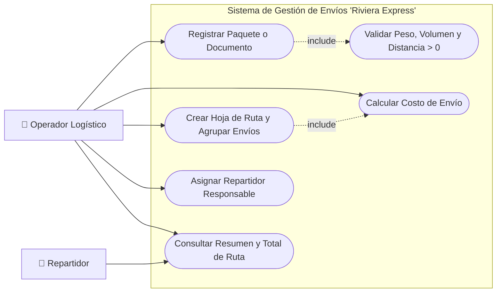
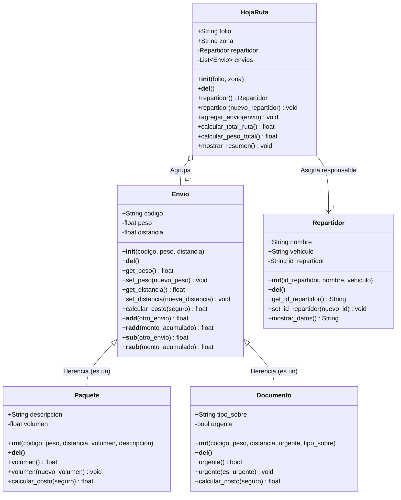

# Fases 2 y 3: Análisis y Diseño · "Riviera Express"

## Fase 2: Análisis

### 2.1 Identificación de Objetos / Clases Candidatas

1. **`Envio` (Superclase)**:
   - **Atributos**: `codigo`, `peso`, `distancia`.
   - **Responsabilidades**: Validar que peso y distancia no sean negativos (`get`/`set`), calcular el costo base por peso y distancia, y sobrecargar los operadores `+` y `-` para sumar o descontar envíos.
2. **`Paquete` (Subclase de `Envio`)**:
   - **Atributos propios**: `volumen`.
   - **Responsabilidades**: Validar que el volumen no sea negativo (`@property`) y calcular el costo total sumando el cargo por volumen al costo base heredado.
3. **`Documento` (Subclase de `Envio`)**:
   - **Atributos propios**: `urgente`.
   - **Responsabilidades**: Gestionar el estado de urgencia (`@property`) y calcular el costo sumando una tarifa adicional si el documento es urgente.
4. **`Repartidor`**:
   - **Atributos**: `id_repartidor`, `nombre`, `vehiculo`.
   - **Responsabilidades**: Almacenar y validar los datos del repartidor responsable (`get`/`set`) y mostrar su ficha de identificación.
5. **`HojaRuta`**:
   - **Atributos**: `folio`, `zona`, `repartidor`, `envios`.
   - **Responsabilidades**: Agrupar varios envíos, asignar un repartidor responsable, calcular el peso y costo total acumulado de la ruta y mostrar el resumen diario.

### 2.2 Diagrama de Casos de Uso

---

## Fase 3: Diseño

### 3.1 Diagrama de Clases UML

