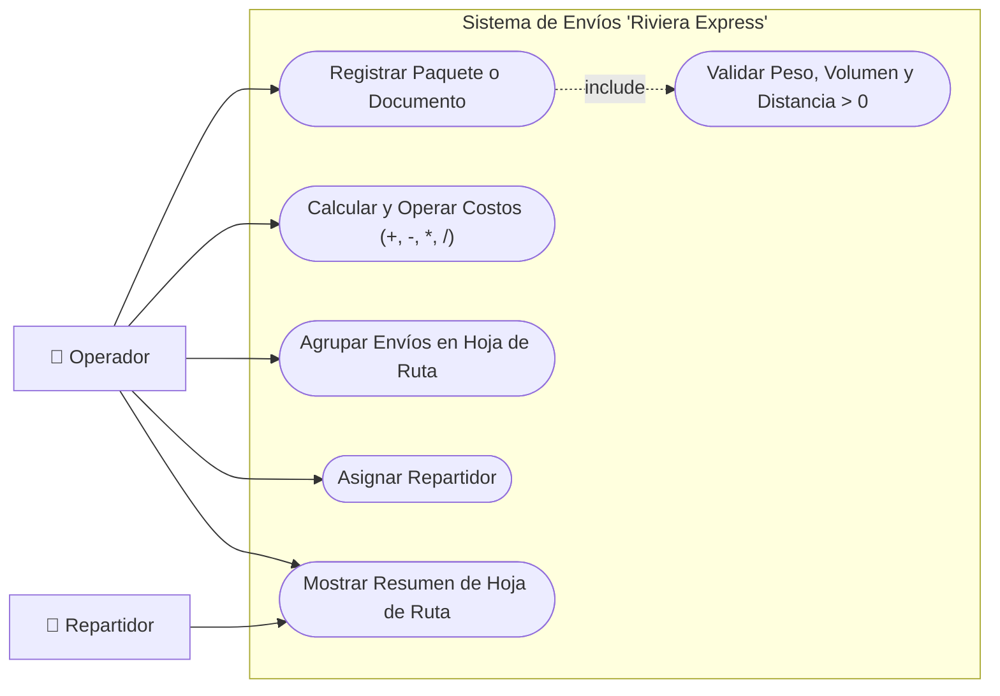
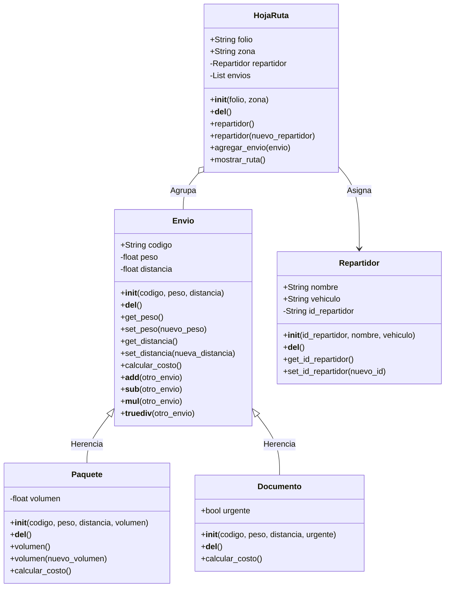

# Fases 2 y 3: Análisis y Diseño · "Riviera Express"

## Fase 2: Análisis

### 2.1 Lista de Objetos Identificados en el Dominio

1. **`Envio` (Superclase)**:
   - **Atributos**: `+codigo`, `-peso`, `-distancia`.
   - **Responsabilidades**: Inicializar y destruir el objeto (`__init__`, `__del__`), validar que peso y distancia no sean negativos (`get`/`set`), calcular el costo base y sobrecargar los 4 operadores aritméticos (`+`, `-`, `*`, `/`).
2. **`Paquete` (Subclase de `Envio`)**:
   - **Atributos propios**: `-volumen`.
   - **Responsabilidades**: Heredar de `Envio`, validar que el volumen no sea negativo mediante `@property` y calcular el costo sumando el volumen al costo base.
3. **`Documento` (Subclase de `Envio`)**:
   - **Atributos propios**: `+urgente`.
   - **Responsabilidades**: Heredar de `Envio` y calcular el costo sumando un cargo adicional cuando el documento es urgente.
4. **`Repartidor`**:
   - **Atributos**: `+nombre`, `+vehiculo`, `-id_repartidor`.
   - **Responsabilidades**: Representar al repartidor responsable de la entrega y encapsular su identificador mediante `get`/`set`.
5. **`HojaRuta`**:
   - **Atributos**: `+folio`, `+zona`, `-repartidor`, `-envios`.
   - **Responsabilidades**: Encapsular al repartidor asignado mediante `@property`, agrupar múltiples paquetes y documentos en una lista y mostrar en pantalla los datos de la ruta.

### 2.2 Diagrama de Casos de Uso

---

## Fase 3: Diseño

### 3.1 Diagrama de Clases UML

